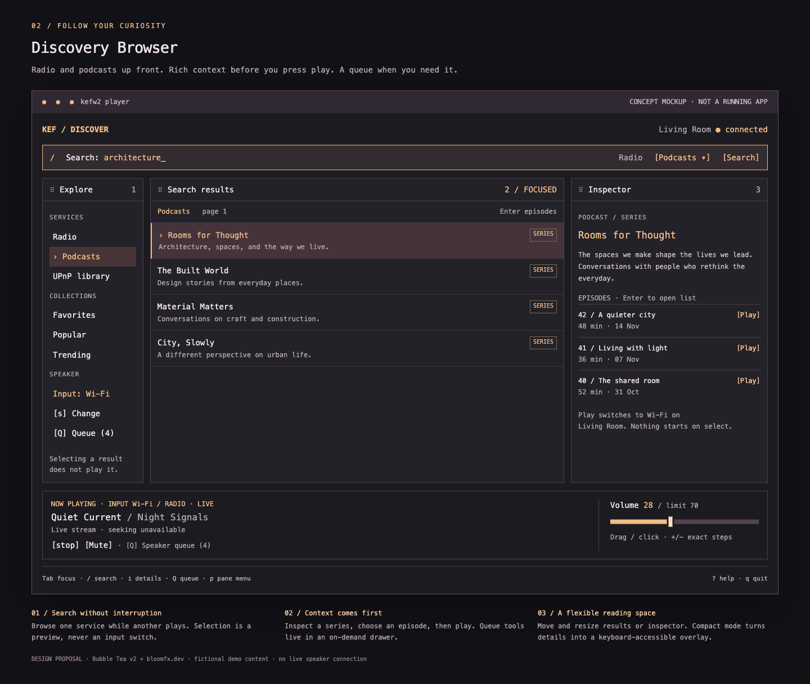
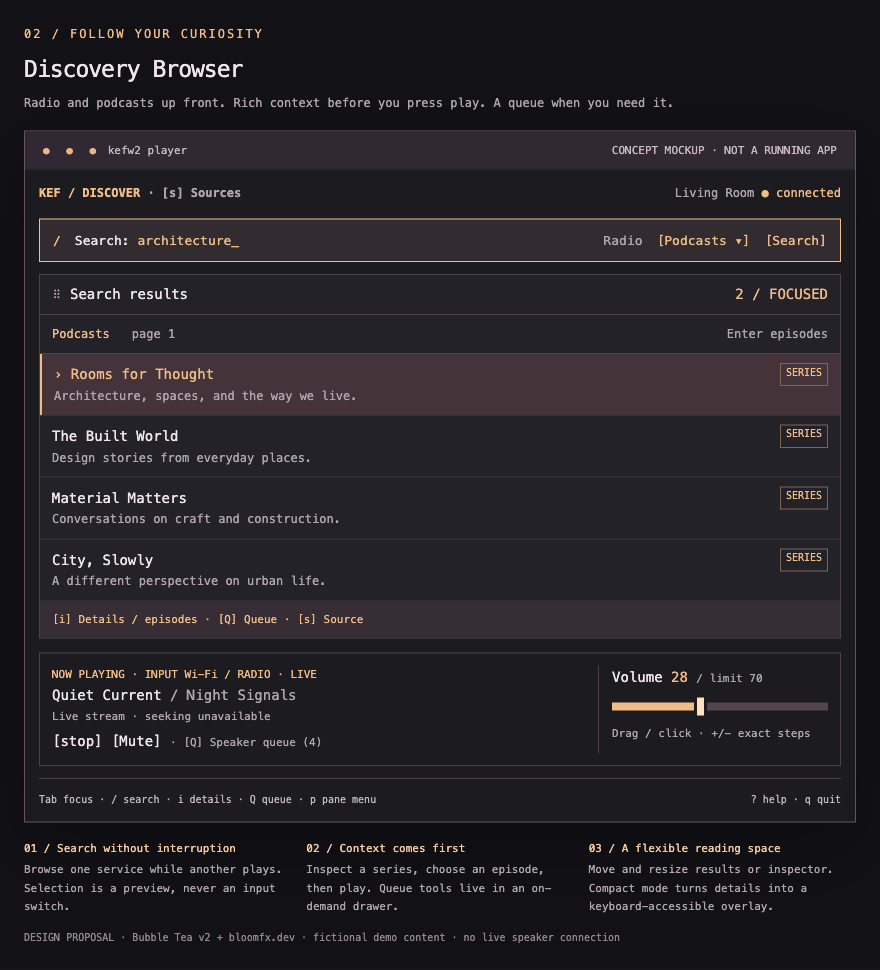

# Player concept 2: Discovery Browser

**Positioning:** a search-first `kefw2 player` for people who move between radio
stations and podcast episodes more often than they curate music queues. This is
a design proposal, not an implemented command.

## Experience and trade-offs

A warm, editorial terminal browser with three working areas: service navigation,
results, and an inspector. A prominent query field stays above the panes.
Switch Radio/Podcasts with a visible selector, never by guessing query syntax.
Selecting a result updates details without playing anything. Enter opens a
podcast series; a second Enter on an episode plays it. A radio station has an
explicit Play action. The transport reports the actual input even while browsing
another service.

Compared with Listening Desk, this prioritizes discovery and readable episode
descriptions. Compared with Queue Studio, ordering takes one more step: Queue
opens as a drawer. The advantage is less competing information during search;
the cost is reduced awareness of the upcoming queue. The recommended general
default remains Listening Desk; this is the specialist discovery direction.

## Pane layout and movement

At 120+ columns and 32+ rows, show service/navigation (22 cells), results (fill,
minimum 38), and inspector (40). Search and transport are fixed outside the
docking tree. Drag any title grip to swap dock positions; resize by dragging
dividers. Double-click title / `z` with pane focus zooms it. The pane menu (`p`)
offers Move (arrows between slots), Resize (arrows adjust cells), Zoom and Reset;
Enter commits and Esc restores. A drag previews its destination before commit.

At 90-119 columns collapse the service navigation into a chooser. Below 90,
replace the inspector with a Details overlay; results retain the available
width. The Queue drawer becomes full-screen in compact mode but keeps a small
input/volume status line. Do not permanently change saved pane order when
collapsing. Below 60x18 show an explicit minimum-size warning with quit and mute
available. Reduce list height first on short terminals.

Queue is an explicit view of the speaker's active queue, not a saved playlist
editor. In a wide terminal its drawer can be docked in place of the inspector.
Do not enqueue radio stations or podcast episodes unless their service
capability and payload have been verified; unsupported items show Play only.

## Interaction contract

| Action | Mouse | Keyboard |
|---|---|---|
| Focus | Click pane/control | Tab / Shift+Tab; pane menu names all panes |
| Search | Click query, select service, press Search | `/` focuses query, Tab selects service, Enter submits |
| Browse | Click row, wheel scroll | Arrows / j/k; PageUp/PageDown; Home/End |
| Details | Select result; click Details when compact | `i` opens/closes inspector overlay |
| Play | Click explicit Play; double-click playable leaf | Enter on playable leaf; series first opens episodes |
| Back | Click breadcrumb | Esc returns from episode list or closes overlay first |
| Source | Click input badge | `s` chooser, arrows, Enter; Esc cancels |
| Queue | Click Queue badge | `Q` toggles drawer; Ctrl+k/j reorders selected queue item |
| Queue drag | Drag a row grip to insertion line | Ctrl+k / Ctrl+j; no drag-only operations |
| Volume | Click/drag slider; wheel over slider only | +/- outside input; focused slider Left/Right, Up/Down by 5 |
| Mute / transport | Click labeled controls | `m`, Space, `[`/`]` outside inputs |
| Move / resize pane | Drag title / divider | `p` > Move or Resize, arrows, Enter commit, Esc restore |
| Help / quit | Click labels | `?`; `q` outside input; Ctrl+c always |

Normal clicks select, not play; double-clicking a podcast series only opens it.
Search inputs receive spaces, letters, `+`, `-`, and cursor keys without triggering
player shortcuts. Modal focus is scoped and restored to the originating row.
The pane menu provides access when Alt combinations are intercepted by a
terminal. All focused controls have a text marker and contrasting border, not
just a color change. Slider Home/End choose zero/the allowed maximum.

## Search and state flow

Use Bubble Tea v2, Bubbles text inputs/viewports, and a pointer model containing
`bloom.Root` and `bloom.Focus`. Bloom handles layout measurement, hit testing,
focus scopes, responsive slots, and modal inspector/queue layers. The application
owns docking, persisted split ratios, splitter drags, slider state and reorder
logic; Bloom does not ship a ready-made player or pane manager. Use stable IDs
for hit tests and moving nodes. Pass all messages through `ui.Update`; avoid
processing a mouse action twice.

Propose `kefw2 player` using existing speaker configuration. Keep existing
commands and machine-readable contracts unchanged. Only a future implementation
adds the command and updates `cmd/kefw2/cmd/skillassets/guide.md`.

Submit searches explicitly, not on every keystroke. Each query/service/navigation
change increments a generation number. Asynchronous results apply only to the
matching generation. Use `SearchRadioPage` for bounded radio pages;
`SearchPodcasts` for the first podcast page and `GetRows` with the returned service
path/ranges for further pages. Follow podcast series to their episode containers.
Keep pagination explicit. Preserve query, selection, and scroll position when
returning from details. Show loading, empty, end-of-results, and errors separately.
A failed request keeps previous results visibly marked as belonging to their old
query; Retry targets the failed query, not a stale selection.

Use exact service paths, not station titles, for identity. Radio playback uses
`ResolveAndPlayRadioStation`; podcast playback uses
`PlayPodcastEpisodeExact` after resolving the series/episode. Selecting a result
never switches the speaker. Play identifies the target speaker and will activate
Wi-Fi as required; wait for success before showing it as the actual input.

Queue drawer: `GetPlayQueue`, `MoveQueueItem`, `RemoveFromQueue`,
`PlayQueueIndex`. Serialize edits; refresh the ordered snapshot before resolving
selected occurrences and indices, including repeated paths. If the snapshot
changed, abandon the move with a visible retry prompt. Refetch after mutation;
never report success solely from an optimistic local sort. The index-based API
still has a concurrent-controller race between refresh and write; do not promise
atomic conflict prevention.

Transport/state reuse the event-triggered snapshot approach in
`cmd/kefw2/cmd/status_watch.go`, with `KEFSpeaker` source/volume/mute/transport
methods. I/O runs in commands/workers and is canceled at exit. Disable unsupported
transport per source/stream. Do not seek live radio; external inputs can display
`external audio / metadata unavailable`. Radio/Podcasts are Wi-Fi services, not
physical inputs. Input availability depends on the speaker model.

## Slider, persistence, and errors

Yes, a slider is feasible: render a cell track with Bloom `on.ClickAt` and
`on.Drag`. Map the clamped local x-coordinate over `w-1` to
`0..min(100, maxVolume)`; guard width 0/1. Display numeric requested/confirmed
values. Coalesce to at most ten writes/second, keep one write in flight, replace
intermediate targets, and flush the last target on release. Read back confirmation.
On failure restore confirmed volume, show an inline error and explicit Retry.
Do not retry mutations on reconnect. Failed maximum-volume loading disables
increases with an explanation, not a guessed limit; known-state decreases and
mute remain available.

Proposed versioned `~/.config/kefw2/player-layout.yaml` stores pane IDs, order and
widths using atomic writes; display save/validation errors and offer Reset.
Do not store queries/history or overwrite the user's speaker selection implicitly.
During disconnect preserve a timestamped `STALE` snapshot, disable writes and
leave browsing errors visible. Resume fresh reads on reconnect, not failed edits.
Reduced-motion and plain-text/no-artwork rendering must remain usable without
mouse or truecolor.

## Acceptance and references

Test keyboard-only search -> series -> episode -> play, radio activation, back
navigation, stale-response rejection, page boundaries and retry identity; queue
duplicate occurrences/conflict rejection; volume clamping/coalescing/final flush
and failure; focus restoration; pane move/resize/cancel; 140x40, 100x30, 80x24,
and below-minimum resize; reconnect without replaying writes. Use fake adapters
and Bloom click/frame helpers, not a live speaker. Demonstrate tests fail when
their guarded behavior is removed.

Screenshots are **static browser-rendered terminal mockups with fictional demo
content**, not a working Bubble Tea application. The self-contained
[HTML mockup](../designs/player-discovery-browser/index.html) reproduces wide and
compact views at browser sizes 1440x1000 and 880x850; widths are illustrative,
not a terminal-cell rendering guarantee.

Sources: [Bloom mouse](https://bloomfx.dev/input/mouse), [focus
scopes](https://bloomfx.dev/input/focus), [responsive
layout](https://bloomfx.dev/layout/responsive), [showcase docking
example](https://github.com/lrstanley/bloom/tree/master/_examples/showcase);
repository `kefw2/airable_radio.go`, `airable_podcast.go`, `queue.go`,
`kefw2.go` and `cmd/kefw2/cmd/status_watch*.go`.
