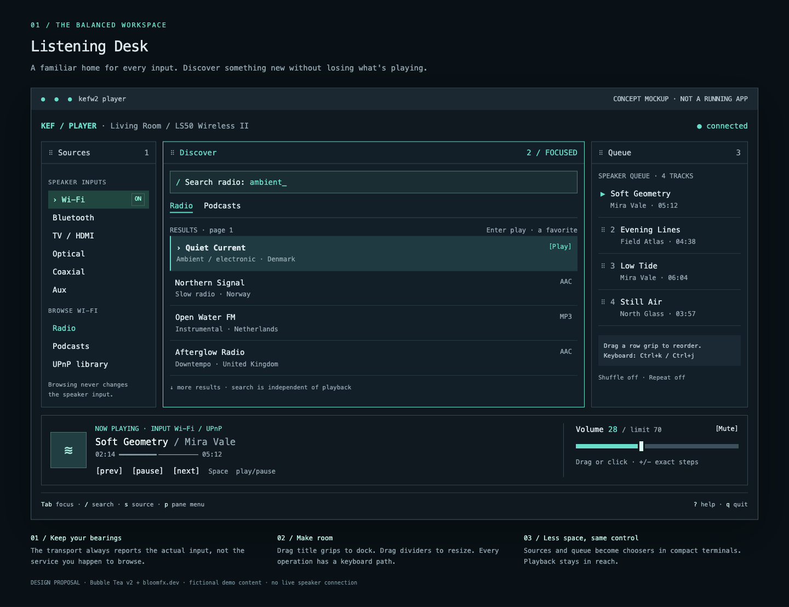
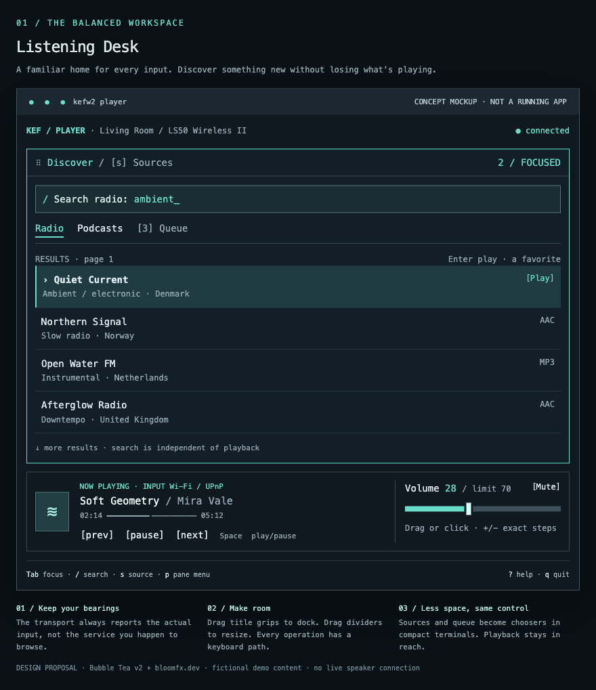

# Player concept 1: Listening Desk

**Recommendation:** the strongest default for `kefw2 player`. Sources, discovery,
now playing, and the queue stay visible without making any one workflow dominate.
This is a design proposal, not an implemented command.

## Experience and trade-offs

A quiet, cyan-accented workspace: sources on the left, a large discovery pane in
the middle, and a queue on the right. A persistent transport dock shows the
speaker, actual input, playback metadata, connection health, and volume. Browsing
Radio does not imply the speaker has switched inputs: the dock continues to say,
for example, `INPUT Optical / external audio` until a successful source change.
Radio and Podcasts are content services within Wi-Fi, not physical inputs.

This is the most balanced of the three proposals. It gives up the expansive
search preview of Discovery Browser and the dense ordering tools of Queue Studio
in exchange for lower learning cost and fewer mode switches.

## Pane layout

At 120+ columns and 32+ rows, use three columns: Sources (24 cells), Discover
(remaining width, minimum 42), Queue (32). Keep the transport and one-line
context-sensitive help outside the pane tree. These are terminal-cell targets;
the accompanying HTML is an illustrative mockup, not a cell-exact renderer.

Drag a pane's title grip to another dock position; a placeholder previews the
drop. Drag a one-cell divider to resize adjacent panes, respecting minimums.
Double-click a title or press `z` with pane focus to zoom/unzoom. A normal title
click only focuses, so double-click does not also perform a destructive action.
Save pane order and widths, not absolute screen coordinates.

At 90-119 columns, turn Queue into a tab beside Discover. Below 90 columns, also
replace Sources with a source chooser. `Tab` and numbered pane shortcuts still
reach collapsed panes as overlays. Below 60x18, show an explicit size warning,
but retain quit and mute. Short terminals reduce visible list rows before
collapsing detail content. Enlarging restores the user's layout and selection.

## Interaction contract

| Action | Mouse | Keyboard |
|---|---|---|
| Focus | Click pane/control | Tab / Shift+Tab; Alt+1/2/3 for panes |
| Navigate | Wheel; click row | Arrows or j/k; PageUp/PageDown; Home/End |
| Activate | Click Play button; double-click result | Enter; podcast series opens episodes first |
| Search | Click search field; choose Radio/Podcasts | `/`; Tab to service selector; Enter submits |
| Source | Select source, activate Switch | `s`, choose, Enter; Esc cancels |
| Volume | Click/drag slider; wheel only over slider | `+`/`-` outside text input; slider Left/Right |
| Mute | Click Mute | `m` outside text input |
| Playback | Click transport | Space toggles; `[`/`]` previous/next outside inputs |
| Queue order | Drag row grip; insertion line previews destination | Ctrl+k / Ctrl+j moves selected row |
| Pane placement | Drag title grip | `p` opens pane menu: Move, Resize, Zoom, Reset |
| Pane resizing | Drag divider | Pane menu > Resize, arrows, Enter commit, Esc restore |
| Help / quit | Click help / Quit | `?`; `q` outside inputs; Ctrl+c always |

The pane menu's Move action uses arrows between dock targets, Enter commits and
Esc restores. It also exposes named pane choices, so Alt-key terminal conflicts
never make a pane inaccessible. Text inputs receive printable keys, spaces, and
cursor keys before application shortcuts. Modal focus is trapped and restored.
When a slider has focus, Home/End select zero/the allowed maximum; Up/Down
change by five points. No shortcut raises the speaker's configured maximum.

## Volume slider: yes

Build a horizontal track using Bloom `on.ClickAt` and `on.Drag`; it is a custom
control, not an assumed built-in slider. For a track of width `w > 1`, map
`clamp(x, 0, w-1) / (w-1)` to `0..min(100, maxVolume)`, rounding to an integer.
Handle width 0/1 explicitly. Show both requested and confirmed values while a
write is pending. A cell-based slider has finite precision; keys provide exact
single-point adjustments.

Coalesce drag updates to at most ten writes per second, with one volume request
in flight and the latest target replacing intermediate targets. Always flush
the final target after release. Read back the confirmed value; on failure revert
to the last confirmed value with a persistent error and Retry. Do not retry
volume changes automatically after reconnect. If the maximum cannot be loaded,
disable volume increases and explain why; mute and decreases remain available
when their required state is known.

## Data flow and implementation boundary

Propose one new Cobra subcommand, `kefw2 player`, retaining existing speaker
selection/configuration. Do not change `status watch` or its JSON contracts.
Production implementation must update the embedded
`cmd/kefw2/cmd/skillassets/guide.md` when the command is actually added.

Use the existing Bubble Tea v2 stack. A pointer-owned player model owns
`bloom.Root`, `bloom.Focus`, pane state and child Bubbles inputs/viewports.
Bloom supplies rows/columns, slots with minimums and collapse priorities,
focus scopes, modal layers and hit testing. **Docking, splitter state, slider,
and queue drag/drop are application logic**, following Bloom's showcase; they
are not a ready-made window manager. Stable pane/row IDs survive reordering.
Pass messages to `ui.Update` and handle mouse actions only once.

Reuse `KEFSpeaker.Source`, `SetSource`, `GetVolume`, `GetMaxVolume`, `SetVolume`,
`Mute`/`Unmute`, and supported transport operations. Reuse the event invalidation
and snapshot approach from `status_watch.go`: events trigger refreshed state,
not blind assumptions about success. Run speaker/network I/O in commands or a
serialized worker, never in View or mouse callbacks; cancel on exit.

Discovery uses `SearchRadioPage`, bounded `SearchPodcasts` results and service
containers to reach episodes. Fetch additional pages explicitly through
`GetRows` using service paths/ranges; never download an entire catalogue merely
to draw a list. A query generation number discards late results; show loading,
empty results, service errors and Retry separately.

The queue uses `GetPlayQueue`, `MoveQueueItem`, `PlayQueueIndex` and
`RemoveFromQueue`. "Playlist ordering" means the active speaker queue, not
silently rewriting a saved playlist. Before a move, refresh and compare the
ordered snapshot, resolve the selected occurrence (including duplicate paths),
serialize the mutation, then refetch. If another controller changed the queue,
cancel and ask the user to retry; the index-based API cannot guarantee an atomic
compare-and-swap. No claim of race-free edits against concurrent controllers.

Wi-Fi services and queue playback must be explicitly activated. A Radio station
uses `ResolveAndPlayRadioStation`; episodes use the exact episode API where
applicable. These may replace current playback, so show the target speaker/input
in the action. Never claim radio is seekable or universally enqueueable. TV,
Optical, Coaxial, Aux and USB show external audio when metadata is unavailable;
disable unsupported transport with a reason. Bluetooth/Wi-Fi capability is not
proof that a particular stream can seek. Show seek only with known duration and
supported media. Unsupported physical inputs are omitted/disabled per model.

Persist layout only in a proposed versioned
`~/.config/kefw2/player-layout.yaml`, with atomic writes and visible save errors.
Validate IDs and widths; offer Reset for invalid files instead of silently
discarding them. Never persist search history or playback changes implicitly.

## Failure states and acceptance

Keep the last confirmed snapshot marked `STALE` with its age during disconnect;
disable writes until reconnect and require explicit retry of failed mutations.
Keep errors in the affected pane rather than only in a disappearing toast.
Render a text-only fallback without artwork, truecolor, mouse, or animation.
Reduced-motion disables transitions; focus uses a marker and border as well as
color. Escape always cancels an uncommitted drag/menu, never stops playback.

Implementation tests should cover keyboard/mouse parity for source selection,
search, volume endpoints/clamping/coalescing, drag final flush and write failure;
duplicate queue entries and concurrent-change rejection; query response ordering;
modal focus restoration; pane move/resize/cancel; reconnect without replayed
mutations; and resize at 140x40, 100x30, 80x24 and below minimum. Use fake speaker
adapters and Bloom's frame/click helpers; no live speaker required. Prove each
behavioral test fails when that behavior is removed before accepting it.

## Visuals and references

The screenshots are **static browser-rendered terminal design mockups**, using
fictional metadata, not screenshots of a running Go/Bloom app. The standalone
[mockup](../designs/player-listening-desk/index.html) has no remote dependencies.
Reproduce with a local HTTP server and a browser at 1440x1000 and 880x850.

Verified against [Bloom mouse](https://bloomfx.dev/input/mouse),
[focus](https://bloomfx.dev/input/focus), [responsive
layouts](https://bloomfx.dev/layout/responsive), and the [showcase
application](https://github.com/lrstanley/bloom/tree/master/_examples/showcase).
Repository anchors: `kefw2/queue.go`, `kefw2/airable_radio.go`,
`kefw2/airable_podcast.go`, `kefw2/kefw2.go`,
`cmd/kefw2/cmd/status_watch.go` and `status_watch_controls.go`.
