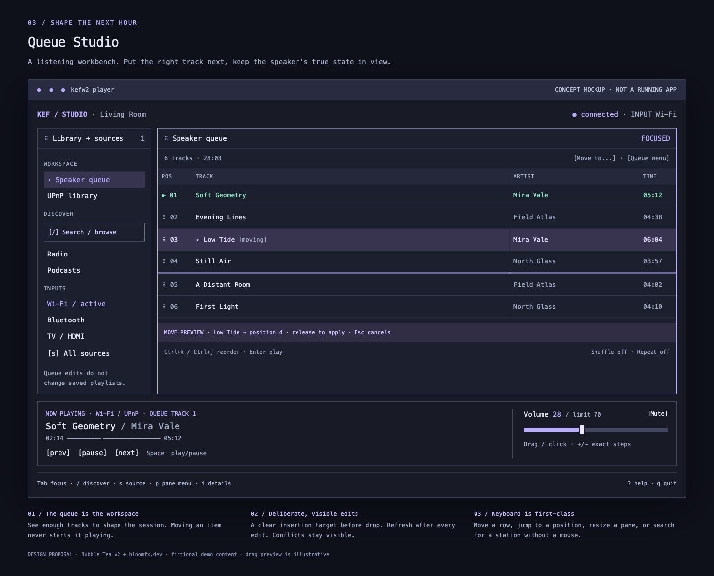
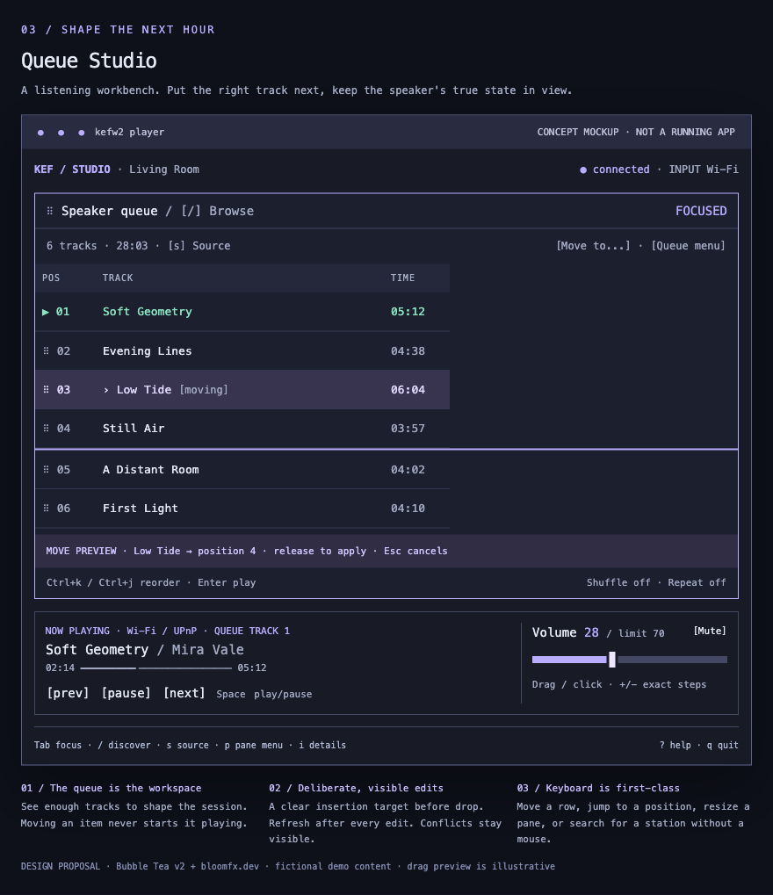

# Player concept 3: Queue Studio

**Positioning:** a queue-first `kefw2 player` for intentional listening and
playlist sequencing. The active speaker queue is the workspace, not a small
sidebar. This is a design proposal, not an implemented command.

## Experience and trade-offs

A precise, violet-accented workbench puts a full-width ordered queue beside a
compact source/library pane. The lower strip combines now-playing status,
transport, and volume. Radio and podcast search remain one action away in a
dockable browser, but do not compete with the playlist.

Unlike Listening Desk, this gives ordering enough width for track, artist,
duration, position and a visible insertion target. Unlike Discovery Browser, it
optimizes repeated listening and queue editing, not browsing long descriptions.
Its trade-off is greater density and one extra action to search. Choose this for
frequent queue management; Listening Desk is the recommended broad-audience
default.

"Playlist order" specifically means the active speaker queue in this proposal.
Do not silently edit or overwrite saved playlists. No local-only sort may be
presented as a successfully reordered speaker queue.

## Layout and pane mechanics

At 120+ columns and 32+ rows, use a 26-cell source/library pane and a queue that
fills the rest (minimum 58). A dockable browser opens on the right only when
requested; it may replace the library pane at intermediate widths. Now Playing,
transport and volume stay outside the pane tree.

Drag a title grip to reorder docks, drag a divider to resize, and double-click
the title / press `z` on pane focus to zoom. A pane menu (`p`) has Move, Resize,
Zoom, Hide/Show Browser and Reset. Move uses arrows to choose a dock; Resize uses
arrows to adjust cells; Enter commits and Esc restores. Both pointer and keyboard
show the same preview. Save order and widths, not raw pointer coordinates.

At 90-119 columns hide the artist column before collapsing the library pane.
Below 90, use Queue / Browse tabs and a source chooser. Below 75, also omit the
duration column. The queue retains position, title, focus, selection and the
playing marker. Long titles truncate by display-cell width; Details reveals full
metadata. At less than 60x18 show an explicit size warning with quit and mute
available. Short terminals reduce queue rows; growing restores the layout and
selection. Cell thresholds are implementation targets; HTML is illustrative.

## Interaction contract

| Action | Mouse | Keyboard |
|---|---|---|
| Focus / select | Click pane/row, wheel | Tab / Shift+Tab; arrows / j/k; PageUp/Down; Home/End |
| Play queue item | Explicit Play or double-click row | Enter |
| Move queue item | Drag row grip to insertion line | Ctrl+k / Ctrl+j; Move To action for exact position |
| Remove / clear | Row menu / queue menu | Delete opens confirmation; Clear only through confirmation |
| Search services | Click Browse, choose Radio/Podcasts | `/` opens browser query; Tab service; Enter submits |
| Podcast navigation | Click series, then episode | Enter opens series; Enter on episode plays |
| Source | Click input badge / source | `s`, arrows, Enter; Esc cancels |
| Volume | Click/drag slider; wheel over slider only | +/- outside inputs; slider Left/Right; Up/Down by 5 |
| Mute / transport | Click controls | `m`, Space, `[`/`]` outside inputs |
| Pane move / resize | Drag title / divider | `p` > Move or Resize, arrows, Enter commit, Esc restore |
| Details / help / quit | Click labels | `i` / `?` / `q` outside inputs; Ctrl+c always |

The Move To dialog uses a 1-based visible position; convert to the API's 0-based
index only at the boundary. Validate range and leave invalid input visible with
an error. A drag does not change speaker state until drop. Escape restores the
pre-drag order. Row identity is separate from index and title. Focus/playing
markers are not moved merely because another row is selected.

Every action is reachable through Tab or the pane/row menus; no Alt key
combination is required. Search/dialog text receives printable keys, spaces, and
cursor keys before global shortcuts. Modal focus is trapped and restored.
Queue shortcuts are active only with queue focus. A disabled action explains
why. Slider Home/End selects zero/the allowed maximum.

## Queue correctness and library reuse

Propose `kefw2 player` with existing configuration/speaker selection. Future
implementation must add the command to the embedded
`cmd/kefw2/cmd/skillassets/guide.md`; this proposal changes no CLI behavior.

Use the existing Bubble Tea v2 stack, with a pointer model containing
`bloom.Root`, `bloom.Focus`, queue snapshot, selected occurrence, drag draft and
pane arrangement. Bloom supplies layout slots, minimums/collapse, modal layers,
hit testing, focus scopes and optional transitions. Application code owns the
docking manager, splitters, queue insertion logic and custom slider. Give
moving pane/row nodes stable IDs and pass messages to `ui.Update` without
double-dispatching mouse actions. Never do I/O in View or handlers.

`GetPlayQueue` supplies canonical order. `MoveQueueItem(fromIndex, toIndex)`
performs a single-row move; `PlayQueueIndex` starts the selected queue occurrence.
Refresh immediately before a queued mutation and compare ordered snapshots.
Track duplicate paths using occurrence identities scoped to that snapshot; a
path or title alone is insufficient. If order/content changed, cancel with
`Queue changed elsewhere; review and retry`. Serialize edits, refetch after each,
and only then clear the pending marker. No blind retry on network failure:
the operation may already have reached the speaker. Refetch first, report
uncertainty, and let the user issue a fresh action.

The API is index-based with no compare-and-swap token, so a change between the
refresh and write remains possible. Call that limitation out in implementation
review and test at least the detectable conflicts. During the pending round trip
disable further queue edits, not unrelated volume control. Omit multi-row moves,
undo history and saved-playlist editing in the first version; those would require
stronger transactional semantics than the current API offers.

Use `RemoveFromQueue` after a focused confirmation; clear requires a separate
confirmation with the item count. Drag preview order never changes actual
playback. Do not automatically start playing after a reorder.

## Discovery, transport, and volume

The browser uses `SearchRadioPage`, bounded `SearchPodcasts`, and `GetRows`
service paths/ranges for more pages and episode navigation. Submit explicitly;
generation numbers discard old replies. Preserve previous results with an
old-query label during errors; separate empty, loading and failed states.
Use exact result identities, `ResolveAndPlayRadioStation` and
`PlayPodcastEpisodeExact`, not title matching. Show Play for radio/episodes;
only expose Add to Queue for verified supported content such as UPnP tracks
using `AddToQueue`. Do not assume every radio/podcast resource is enqueueable.
Play explicitly activates Wi-Fi as required and identifies the target speaker.

Reuse `KEFSpeaker` source, volume, maximum, mute and supported transport methods,
plus the event-invalidation/snapshot approach in `status_watch.go`. The persistent
dock reports the actual input, independently of browsing and queue contents.
Wi-Fi services are not physical inputs. Unsupported model inputs are hidden or
disabled. TV/Optical/Coaxial/Aux/USB show external audio when metadata is missing;
disable unsupported transport with a reason. Seek requires known duration and
supported media; never show seeking for live radio.

Yes, the volume slider is a custom Bloom control: `on.ClickAt` and `on.Drag`
provide local coordinates. Clamp x into `0..w-1`, guard w <= 1, and map to
`0..min(100, maxVolume)`. Keys provide exact single-point precision. Coalesce
drag requests to at most ten writes/second, with one request in flight and
latest-target replacement; always flush the final value on release. Display
pending versus confirmed volume, read back after write, and restore confirmed
state with a persistent error on failure. If loading the maximum fails, disable
increases with an explanation, not an assumed ceiling. Known-state decreases
and mute stay available. Reconnect never replays failed volume or queue writes.

## Persistence, errors, and acceptance

Proposed versioned `~/.config/kefw2/player-layout.yaml` stores pane IDs/order/widths
atomically. Validate at load and show errors with a Reset option; surface failed
saves. Do not persist queue drafts or mutate queues on startup. Cancel background
work on exit. On disconnect show a timestamped `STALE` snapshot and disable
writes until refreshed. Errors stay in the affected pane until dismissed/retried.
Artwork is optional; plain-text, mouse-free and reduced-motion modes remain
complete. Focus uses markers/borders, not color alone.

Acceptance tests: exact first/last queue moves and Move To indexing; duplicate
occurrences; canceled drags; no playback on reorder; conflict rejection; ambiguous
network mutation followed by refetch; keyboard/mouse action parity; source and
stream capability gates; stale search replies and pagination; slider endpoints,
configured maximum, coalescing, final flush and failure; focus restoration;
pane move/resize/cancel; layouts at 140x40, 100x30, 80x24 and below minimum.
Use fake speaker adapters and Bloom frame/click helpers. Verify behavioral tests
fail when the corresponding logic is removed.

## Visuals and references

The screenshots are **static browser-rendered terminal design mockups** with
fictional tracks, not screenshots of running Go code. Reproduce the standalone
[mockup](../designs/player-queue-studio/index.html) at 1440x1000 and 880x850.
No new dependency or speaker interaction is needed to review this design.

Sources: [Bloom mouse](https://bloomfx.dev/input/mouse), [focus
scopes](https://bloomfx.dev/input/focus), [responsive
layout](https://bloomfx.dev/layout/responsive), [showcase docking
example](https://github.com/lrstanley/bloom/tree/master/_examples/showcase);
repository `kefw2/queue.go`, `airable_radio.go`, `airable_podcast.go`, `kefw2.go`,
`cmd/kefw2/cmd/queue.go` and `status_watch*.go`.
